<div align="center">



# 🚀 Awesome Spatial Presentation & Gesture Control 🖐️

**A curated index of enterprise SaaS platforms and high-performance open-source tools for touchless presentations, spatial computing workspaces, IMU air-pointers, and computer-vision hand tracking.**

<p align="center">
  <a href="https://github.com/ishandutta2007/Awesome-Awesome-Awesome"></a><a href="https://discord.gg/jc4xtF58Ve"></a>
  <a href="https://awesome.re"></a>
  <a href="https://github.com/ishandutta2007/Awesome-Spatial-Presentation-Gesture-Control"></a>
  <a href="https://github.com/ishandutta2007/Awesome-Spatial-Presentation-Gesture-Control/pulls"></a>
  <a href="https://github.com/ishandutta2007/Awesome-Spatial-Presentation-Gesture-Control/blob/main/LICENSE"></a>
  <a href="https://github.com/ishandutta2007"></a>
</p>

</div>

---

## 📖 Overview

Welcome to the definitive developer and presenter directory for **Spatial Presentation & Touchless Gesture Control** 🌐🖐️. This ecosystem tracks cutting-edge platforms and open-source frameworks bridging computer vision, wearable IMU sensor fusion, WebXR/OpenXR spatial canvases, and virtual meeting rooms.

Whether you are navigating slide decks hands-free via real-time webcam gesture recognition 📷, broadcasting interactive 3D engineering models across mixed-reality headsets (Apple Vision Pro, Meta Quest) 🥽, or turning consumer hardware (AirPods Pro motion sensors) into low-latency air-mouse pointers 🎯, this curated list aggregates industry leaders and active open-source repositories.

---

## 📑 Table of Contents

- [📊 Sector Overview & Market Dynamics](#-sector-overview--market-dynamics)
- [🏢 SaaS & Hosted Platforms](#-saas--hosted-platforms)
- [💻 Open-Source GitHub Projects](#-open-source-github-projects)
  - [⭐ Top Open-Source Projects (Ranked by Stars)](#-top-open-source-projects-ranked-by-stars)
  - [🛠️ Ecosystem Stacks & Developer Frameworks](#-ecosystem-stacks--developer-frameworks)
- [🏗️ Architecture & Implementation Patterns](#-architecture--implementation-patterns)
- [🤝 How to Contribute](#-how-to-contribute)
- [💖 Support](#-support)
- [📈 Star History](#-star-history)
- [⚠️ Disclaimer & Security Considerations](#-disclaimer--security-considerations)

---

## 📊 Sector Overview & Market Dynamics

The global **spatial computing market** is valued at approximately **$155B–$182B (2025)** and projected to surge past **$470B by 2030** 📈, while the complementary **gesture recognition market** is estimated at **$30.4B–$34.4B (2025)** on track to reach over **$86B–$107B by 2030** (CAGR ~21%–26%). 

The sector exhibits **moderate-to-high fragmentation in software and applications** contrasted with an **oligopolistic, concentrated foundation in hardware and spatial runtimes** dominated by mega-caps (Meta, Apple, Microsoft, Google) 🌐. At the application layer, enterprise spatial collaboration and touchless presentation tooling follow specialized vertical niches—ranging from CAD/3D spatial design reviews to local-first webcam gesture controllers—leaving substantial room for open-source frameworks and vendor-neutral WebXR solutions.

---

## 🏢 SaaS & Hosted Platforms

The table below outlines leading commercial SaaS and hosted platforms for spatial collaboration, virtual workspaces, and immersive 3D presentation review, sorted in descending order by company scale (market capitalization, private valuation, or total venture funding) 💰.

| Product | Valuation / Revenue Scale | Starting Pricing | Free Tier / Free Trial Limits | Description |
| :--- | :--- | :--- | :--- | :--- |
| **[Meta Horizon Workrooms](https://meta.com)** | ~$1.6T+ Market Cap *(Meta Platforms, Inc.)* | $0 / month *(Included with Meta Quest ecosystem)* | **Free forever**: Full access for Meta Quest headset owners (includes multi-screen virtual desktop, passthrough mixed reality, spatial audio, and whiteboard). | Virtual reality workspace and mixed-reality desk integration platform for remote meetings, whiteboarding, and multi-monitor screen presentations. |
| **[Spatial](https://spatial.io)** | ~$200M Valuation *(~$66.8M Total Funding Raised)* | Custom / Quote-based *(Enterprise plans start ~$1,000+/mo for corporate deployments)* | **Free trial**: Customized business pilot/demo available upon request (public consumer self-serve free and pro creator tiers sunsetted). | Enterprise 3D spatial collaboration, interactive virtual venues, and immersive digital event environments accessible across VR, web browsers, and mobile. |
| **[Immersed](https://immersed.com)** | ~$150M–$200M Valuation Cap *(~$37M Total Funding Raised)* | $5.99 / seat / month *(billed annually)* | **Free forever**: Up to 3 virtual screens, standard resolution (1440x900), 2 rotating public co-working spaces, up to 4 collaborators in private rooms. | High-productivity spatial desktop and virtual monitor workspace application supporting multi-display streaming on Meta Quest, Vive, and Apple Vision Pro. |
| **[Glue Collaboration](https://glue.work)** | €3.5M+ Seed Funding *(by Hyperspace / Maki.vc)* | €50 / seat / month *(billed annually)* or €60/seat billed monthly | **Free forever**: Up to 10 team members, 10 persistent 3D team spaces, 2 GB cloud storage, capped at 30 minutes per meeting session. | Cloud-hosted immersive 3D collaboration suite offering customizable virtual presentation rooms, 3D whiteboards, and spatial audio for hybrid teams. |
| **[ShapesXR](https://shapesxr.com)** | $8.6M Total Funding Raised *(Seed Stage)* | $9.99 / user / month *(Creator/Pro tier)* | **Free forever**: 1 active editable Space, up to 10 Frames/scenes per space, 20 MB asset upload limit, and standard Unity/3D export. | Collaborative spatial design, 3D wireframing, and interactive presentation platform built for XR product teams on Meta Quest and Apple Vision Pro. |
| **[Campfire 3D](https://campfire3d.com)** | $8.0M Total Funding Raised *(Seed Stage)* | $125 / seat / month *($1,500/seat/year commercial license)* | **Free forever**: Share up to 5 projects with up to 5 scenes each, 25 MB file size limit, supporting FBX, OBJ, GLTF, USDZ across XR, iPad, and PC. | Holographic collaboration platform allowing distributed engineering, architecture, and manufacturing teams to inspect and present 3D CAD models interactively. |
| **[Arthur VR](https://arthur.digital)** | $5.5M Total Funding Raised *(Draper Associates Seed/Series A)* | $50 / user / month *(Estimated enterprise starting tier)* | **Free trial**: 14-day interactive pilot demo available upon request for enterprise teams (no permanent free tier). | Enterprise virtual reality office and spatial meeting platform offering persistent 3D conference rooms, multi-screen streaming, and spatial audio. |
| **[vSpatial](https://vspatial.com)** | $4.3M Total Funding Raised *(Seed Stage)* | $9.99 / user / month *(Workspace Pro bundle)* | **Free forever**: Local virtual monitors, 1:1 avatar collaboration, spatial audio, and screen sharing (remote desktop sessions capped at 45 minutes). | Spatial computing workplace application allowing users to organize multiple PC desktop displays, browser windows, and decks inside an ergonomic 3D carousel. |
| **[MeetinVR](https://meetinvr.com)** | €1.5M+ Funding *(Service officially sunsetted)* | €35 / user / month *(Historical Pro tier)* | **Free trial (Historical)**: 30-day trial with session watermarks and capped attendee capacity (service now inactive). | Commercial VR meeting suite designed for interactive enterprise presentations, spatial mind-mapping, and touchless 3D whiteboarding. |
| **[ENGAGE XR](https://engagevr.io)** | Former Public AIM-Listed *(Entered Court Liquidation)* | $9.99 / user / month *(Historical Plus subscription)* | **Free forever (Historical)**: Basic attendee access to public virtual spaces and community events with restricted editor tools. | Spatial communications and virtual event platform tailored for university lectures, corporate training simulations, and large-scale 3D stage presentations. |

---

## 💻 Open-Source GitHub Projects

### ⭐ Top Open-Source Projects (Ranked by Stars)

Below are the most prominent open-source projects for gesture recognition, spatial computing runtimes, WebXR presentation platforms, and motion air-pointers, ranked strictly in descending order by GitHub stargazer count 🌟.

| Project & Repository | GitHub Stars | Core Language / Stack | Key Capabilities & Features |
| :--- | :--- | :--- | :--- |
| **[Reveal.js](https://github.com/hakimel/reveal.js)** | [](https://github.com/hakimel/reveal.js/stargazers) | JavaScript / HTML5 | The leading open-source HTML presentation framework; easily integrated with MediaPipe webcam gestures, WebSockets, or leap motion sensor controllers. |
| **[Slidev](https://github.com/slidevjs/slidev)** | [](https://github.com/slidevjs/slidev/stargazers) | Vue.js / TypeScript | Developer-focused presentation slide maker powered by Markdown; provides native Web components, slide hooks, and WebSocket APIs ideal for touchless gesture triggers. |
| **[MediaPipe](https://github.com/google/mediapipe)** | [](https://github.com/google/mediapipe/stargazers) | C++ / Python / JS | Google's ultra-fast cross-platform machine learning framework delivering 21-point 3D hand landmarks and real-time gesture recognition from commodity webcams. |
| **[A-Frame](https://github.com/aframevr/aframe)** | [](https://github.com/aframevr/aframe/stargazers) | WebGL / WebXR / JS | Declarative WebXR entity-component framework for building browser-based 3D presentation spaces, interactive VR rooms, and spatial exhibit displays. |
| **[ALVR](https://github.com/alvr-org/ALVR)** | [](https://github.com/alvr-org/ALVR/stargazers) | Rust / C++ | Open-source remote VR and XR streaming software projecting spatial desktop workspaces and presentations wirelessly from PCs to standalone headsets (Meta Quest, Vision Pro, Pico). |
| **[OpenTrack](https://github.com/opentrack/opentrack)** | [](https://github.com/opentrack/opentrack/stargazers) | C++ / Qt | High-precision open-source 6DOF optical and inertial tracking software bridging webcams, IR trackers, and IMU hardware to desktop mouse emulation and spatial controls. |
| **[Handtrack.js](https://github.com/victordibia/handtrack.js)** | [](https://github.com/victordibia/handtrack.js/stargazers) | JavaScript / TF.js | Lightweight JavaScript library for prototyping real-time hand detection and touchless gesture interactions directly in client-side web browsers with zero installation. |
| **[Lovr](https://github.com/bjornbytes/lovr)** | [](https://github.com/bjornbytes/lovr/stargazers) | Lua / C | Ultra-fast, lightweight open-source Lua engine engineered for building spatial 3D prototypes, VR interactive experiences, and hand-tracked interfaces with minimal friction. |
| **[React XR](https://github.com/pmndrs/react-xr)** | [](https://github.com/pmndrs/react-xr/stargazers) | TypeScript / React Three Fiber | Modern React components and hand-tracking hooks for building WebXR spatial interfaces, touchless slide controls, and immersive 3D presentations. |
| **[Mozilla Hubs (Community Edition)](https://github.com/Hubs-Foundation/hubs)** | [](https://github.com/Hubs-Foundation/hubs/stargazers) | JavaScript / WebXR | Self-hostable, multi-user WebXR spatial meeting environment featuring 3D avatar collaboration, PDF/slide sharing, laser pointers, and spatialized audio. |
| **[HandTracking](https://github.com/victordibia/handtracking)** | [](https://github.com/victordibia/handtracking/stargazers) | Python / TensorFlow | Real-time hand-detection and gesture-tracking framework utilizing trained deep CNNs for touchless computer interaction and presenter tracking. |
| **[Networked-Aframe](https://github.com/networked-aframe/networked-aframe)** | [](https://github.com/networked-aframe/networked-aframe/stargazers) | JavaScript / WebRTC | WebRTC-backed spatial multi-user architecture for A-Frame enabling synchronized presenter avatars, shared audio, and real-time spatial slide clickers. |
| **[StereoKit](https://github.com/StereoKit/StereoKit)** | [](https://github.com/StereoKit/StereoKit/stargazers) | C# / C++ | Open-source OpenXR library tailored for rapid C# development of spatial mixed-reality apps, ergonomic hand-tracked menus, and 3D presentation dashboards. |
| **[Exokit](https://github.com/exokitxr/exokit)** | [](https://github.com/exokitxr/exokit/stargazers) | JavaScript / Node.js | Native open-source WebXR game engine and spatial presentation runtime for running web-first immersive experiences on native VR and AR hardware. |
| **[MousePods](https://github.com/starman-tech/mousepods)** | [](https://github.com/starman-tech/mousepods/stargazers) | Python / Linux | Innovative open-source utility converting Apple AirPods head-tracking IMU sensors into an air-mouse for hands-free cursor movement and presenter slide control. |
| **[Vircadia](https://github.com/vircadia/vircadia)** | [](https://github.com/vircadia/vircadia/stargazers) | C++ / Qt / WebAssembly | Decentralized, self-hosted social VR platform supporting large-scale 3D conferences, multi-user spatial presentations, and cross-platform desktop/XR clients. |
| **[AirPointer](https://github.com/musubipapi/airpointer)** | [](https://github.com/musubipapi/airpointer/stargazers) | Swift / macOS | Transforms an AirPods Pro charging case into a spatial motion air-pointer and slide clicker over Bluetooth using CoreMotion IMU sensors without opening the lid. |
| **[Overte](https://github.com/overte-org/overte)** | [](https://github.com/overte-org/overte/stargazers) | C++ / Qt | Community-driven open-source virtual world engine (forked from High Fidelity) for hosting private, self-hosted 3D presentation auditoriums with spatial audio. |
| **[HandDetection Presenter](https://github.com/beckabec/HandDetection)** | [](https://github.com/beckabec/HandDetection/stargazers) | Python / OpenCV | Human-centered PowerPoint presentation controller using convex hulls, Haar cascades, and motion tracking to advance slides and exit presentations hands-free. |
| **[PptHandGestureRemote](https://github.com/AnonymousAAArdvark/PptHandGestureRemote)** | [](https://github.com/AnonymousAAArdvark/PptHandGestureRemote/stargazers) | Python / PyAutoGUI | Lightweight desktop utility allowing users to control and advance Google Slides and PowerPoint decks using simple computer vision gestures. |
| **[Air-Deck](https://github.com/dannycahyo/air-deck)** | [](https://github.com/dannycahyo/air-deck/stargazers) | TypeScript / Next.js | Browser-based presentation suite pairing a minimalist Markdown slide deck editor with integrated AI webcam gesture-control for slide transitions. |
| **[Hand-Gesture Smart Presentation Controller](https://github.com/Pdanulya/Hand-Gesture-Smart-Presentation-Controller)** | [](https://github.com/Pdanulya/Hand-Gesture-Smart-Presentation-Controller/stargazers) | Python / OpenCV | Webcam-based presentation controller supporting swipe-gesture slide navigation, real-time virtual cursor positioning, and live finger annotation overlays. |
| **[GestureFlow](https://github.com/AkshataKamerkar/GestureFlow)** | [](https://github.com/AkshataKamerkar/GestureFlow/stargazers) | Python / CVZone | Real-time hands-free slide navigation and live annotation whiteboard engine driven by webcam hand recognition and finger landmarks. |
| **[Kinect Gesture Recognition Presentation](https://github.com/arnobt78/Gesture-Recognition-Control-Powerpoint-Presentation--Microsoft-Kinect-Sensor-CSharp-Project)** | [](https://github.com/arnobt78/Gesture-Recognition-Control-Powerpoint-Presentation--Microsoft-Kinect-Sensor-CSharp-Project/stargazers) | C# / Kinect SDK | Controls Microsoft PowerPoint on large auditoriums using Microsoft Kinect depth sensing for gestures like swiping, zooming, and freeze-frame presentation controls. |
| **[AirCanvas](https://github.com/robert-mcdermott/aircanvas)** | [](https://github.com/robert-mcdermott/aircanvas/stargazers) | JavaScript / HTML5 Canvas | Web-based drawing and live annotation tool controlled entirely by finger tracking; built for live presentations, video lectures, and touchless screen highlights. |
| **[Gesture-Controlled Presentation (TechBot505)](https://github.com/TechBot505/Gesture-Controlled-Presentation)** | [](https://github.com/TechBot505/Gesture-Controlled-Presentation/stargazers) | Python / CVZone | Lightweight OpenCV and CVZone slideshow controller enabling mid-air slide transitions, virtual laser pointer mode, and live yellow-line drawings. |
| **[Gesture-Control Presentation System (srutipathak)](https://github.com/srutipathak/gesture-control-presentation-system)** | [](https://github.com/srutipathak/gesture-control-presentation-system/stargazers) | Python / MediaPipe | Hands-free presentation controller using MediaPipe and PyAutoGUI to simulate keyboard keystrokes (`Right` / `Left`) on Google Slides and Keynote. |

---

### 🛠️ Ecosystem Stacks & Developer Frameworks

- **[Monado](https://monado.freedesktop.org/)** 🐧: The leading open-source OpenXR runtime for GNU/Linux, providing the underlying driver infrastructure for 6DOF spatial tracking, headset display composition, and touchless gesture peripherals.
- **[OpenSpace3D](https://www.openspace3d.com/)** 🎮: Free and open-source visual platform for crafting virtual reality spaces, interactive presentations, and multimedia simulations supporting Leap Motion and VR glove integrations.
- **[Ultraleap Unity Plugin](https://github.com/ultraleap/UnityPlugin)** 🖐️: Production-grade hand tracking integration connecting Leap Motion optical hand tracking sensors to 3D virtual buttons and spatial presentation interfaces.

---

## 🏗️ Architecture & Implementation Patterns

How modern developers architect touchless and spatial presentation systems:

```
┌────────────────────────────────────────────────────────┐
│               Input Sensing Layer                      │
│  - Webcam Feed (MediaPipe / Handtrack.js / OpenCV)    │
│  - Wearable IMU Motion Sensors (AirPointer / AirPods) │
│  - Depth Sensing & XR Runtimes (OpenXR / StereoKit)   │
└──────────────────────────┬─────────────────────────────┘
                           │
                           ▼
┌────────────────────────────────────────────────────────┐
│             Gesture Processing & Fusion                │
│  - 21 3D Landmark Estimation & Vector Calculation      │
│  - State Machine (Pinch, Swipe-Left, Swipe-Right, Fist)│
│  - Jitter Filtering & Kalman Filters                   │
└──────────────────────────┬─────────────────────────────┘
                           │
                           ▼
┌────────────────────────────────────────────────────────┐
│              Presentation Dispatch Layer               │
│  - OS-Level Keystrokes (PyAutoGUI / RobotJS)          │
│  - WebSockets / WebRTC (Networked-AFrame, Hubs)       │
│  - HTML5 Slide Deck APIs (Reveal.js / Slidev)          │
└────────────────────────────────────────────────────────┘
```

1. **Local-First Webcam Gesture Controller** 📷: Pair **MediaPipe Hands** with **PyAutoGUI** to translate thumb-to-index pinches into slide clicks, and left/right hand swipes into page flips on PowerPoint, Keynote, or PDF viewers.
2. **Pocket Air-Pointer with IMU Sensors** 🎧: Use **AirPointer** or **MousePods** to read gyro and accelerometer data from consumer wireless earbuds, transforming ordinary hardware into a low-latency 3D laser pointer.
3. **Multi-User Spatial Conference Rooms** 🌐: Deploy **Hubs Foundation (Mozilla Hubs)** or **Overte** on self-hosted infrastructure with WebRTC to conduct 3D presentations where participants navigate virtual auditoriums with spatial audio.

---

## 🤝 How to Contribute

We welcome contributions from presenters, XR engineers, and HCI researchers! ✨

1. **Fork the repository** on GitHub 🍴.
2. **Create a descriptive branch**: `git checkout -b add-my-project`.
3. **Update `README.md`**: Follow the established table formatting for SaaS platforms or Open-Source projects (ensure stargazers badges and links follow `[]`).
4. **Verify links and metrics**: Check that all URLs are live and accurate.
5. **Submit a Pull Request** 🚀: Provide a brief summary of the software and why it benefits the spatial presentation ecosystem.

---

## 💖 Support

Thank you for exploring **Awesome Spatial Presentation & Gesture Control**! 🌟

If you found this curated list helpful for your presentations, research, or development work, please consider supporting the project:

- ⭐ **Star this repository** to help others discover it!
- 🍴 **Fork and contribute** your own tools, libraries, and frameworks.
- 📢 **Share with colleagues**, XR communities, and presentation designers.
- ☕ **Buy a coffee & sponsor ongoing curation**: Visit the [GitHub Sponsor Dashboard](https://github.com/sponsors/ishandutta2007) to back open-source developer tool registries!

---

## 📈 Star History

[](https://star-history.dera.page/#ishandutta2007/Awesome-Spatial-Presentation-Gesture-Control&type=date&legend=top-left)
[](https://www.star-history.com/#ishandutta2007/Awesome-Spatial-Presentation-Gesture-Control&type=date&legend=top-left)

---

## ⚠️ Disclaimer & Security Considerations

- **Community Curated** 🛡️: This repository is a curated community catalog intended for educational and research purposes. Inclusion does not imply commercial endorsement.
- **Camera & Accessibility Permissions** 🔒: Local-first gesture controllers (e.g., Python OpenCV scripts, macOS AirPointer) require access to hardware webcams and OS accessibility APIs (`System Events`, `Input Monitoring`). Always inspect source code before granting privileged operating system permissions.
- **WebXR & WebRTC Requirements** 🌐: Self-hosted spatial presentation servers (such as Hubs or Overte) strictly require secure TLS/HTTPS configurations for modern browsers to unlock camera, microphone, and WebXR device APIs.

---

<div align="center">

Made with ❤️ for keynote speakers, spatial computing pioneers, and open-source engineers.  
**Star this repository** if you find it helpful! ⭐

</div>
